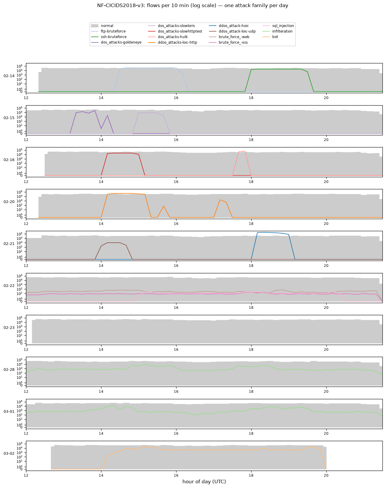
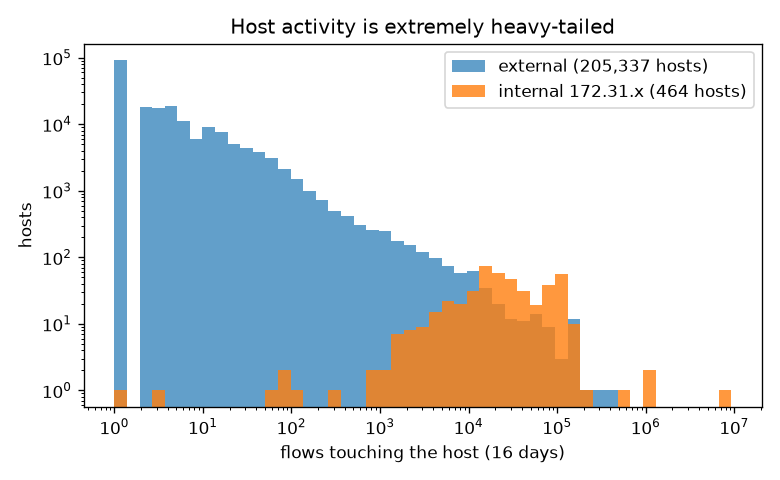

# 01 · Data exploration: NF-CICIDS2018-v3

The full dataset was explored: all **20,115,529 flows**, not a sample, unless stated. The aim is to decide how to
prepare the data, build the graph and choose models and parameters. Every number here was measured on
`data/raw/nf/NF-CICIDS2018-v3.csv` (UQ NetFlow v3 version of CSE-CIC-IDS2018; why this dataset: docs/08).
Figures are in `docs/figures/`.

> The project's first dataset (ToN-IoT) has been removed. Its exploration lives in git history (first commit),
> and what it taught us is summarised in docs/05–08.

## 0. Key takeaways
1. **The labels of 4 attack types are unreliable.** For XSS, SQL injection, Infiltration and web brute force,
   68–91% of "attack" flows have feature vectors that also occur as normal traffic. Their hosts, ports and
   timing show time-window labelling (§6). Exclude them from headline results.
2. **One attack family per day, inside narrow time windows,** so time and attack type are confounded (§3). A
   **day-based split is an unseen-attack test,** and time must never be a feature.
3. **The network is 464 internal hosts (AWS 172.31.x) plus 205,332 external IPs.** Every flow touches an
   internal host; 77% of external IPs appear on only one day (§4). Graphs must be **inductive** (no node ids),
   and external endpoints are mostly degree-1 leaves.
4. **External DoS/DDoS/brute-force attackers are single-purpose hosts, each hitting one victim server.**
   **Bot** is the only clean mixed-role case: 8 internal hosts that behave normally on other days (§4.3).
5. **Within a 5-minute window, graph structure is highly informative.** Per-pair flow count reaches ROC-AUC
   0.96 for bot (best flow feature 0.91), and pair or source flow rate reaches 0.99–1.00 for DoS and brute force
   (§8). The baselines must receive the **same window aggregates** for a fair comparison.
6. **The current random sampling of normal flows destroys graph neighbourhoods.** Keeping 500k of 17.5M normal
   flows removes about 97% of each window's edges. Graph experiments need **complete traffic within the
   selected time windows** (§9.1).

## 1. At a glance
| Property | Value |
|---|---|
| Flows / columns | 20,115,529 / 55 (53 NetFlow fields + `Label` + `Attack`) |
| Time | 14 Feb – 2 Mar 2018, **11 capture days**, only **12:00–21:30 UTC** each day (§3) |
| Classes | normal 87.07%, 14 attack types (§2) |
| Hosts | 205,801: 464 internal (`172.31.0.0/16` and a few link-local/special), 205,332 external public IPs, 5 multicast |
| Host pairs | 1,127,070 undirected; one connected component |
| Flow duration | median 0.03 s, p95 116 s, max 121 s (the exporter's 120 s active timeout) |

## 2. Classes and imbalance
| Class | Flows | Share | | Class | Flows | Share |
|---|---|---|---|---|---|---|
| normal | 17,514,626 | 87.07% | | ssh-bruteforce | 188,474 | 0.94% |
| ddos_attack-hoic | 1,032,311 | 5.13% | | infilteration ⚠ | 188,152 | 0.94% |
| ftp-bruteforce | 386,720 | 1.92% | | dos_attacks-slowhttptest | 105,550 | 0.52% |
| ddos_attacks-loic-http | 288,589 | 1.43% | | dos_attacks-hulk | 100,076 | 0.50% |
| **bot** | 207,703 | 1.03% | | dos_attacks-goldeneye | 61,300 | 0.30% |
| dos_attacks-slowloris | 36,040 | 0.18% | | ddos_attack-loic-udp | 3,450 | 0.017% |
| brute_force_-web ⚠ | 1,618 | 0.008% | | brute_force_-xss ⚠ | 480 | 0.002% |
| sql_injection ⚠ | 440 | 0.002% | | | | |

⚠ = unreliable labels (§6). The imbalance runs from 87% normal down to 440 flows. HOIC alone is 40% of all
attacks, so un-weighted training would learn "HOIC vs normal".

## 3. Time structure

| Day | Normal | Attack (share) | Attack types (UTC window) |
|---|---|---|---|
| 14 Feb | 1,563,644 | 575,194 (26.9%) | FTP brute force 14:33–16:10, SSH brute force 18:01–19:32 |
| 15 Feb | 1,567,981 | 97,340 (5.8%) | GoldenEye 13:27–14:11, Slowloris 15:00–15:41 |
| 16 Feb | 1,578,503 | 205,626 (11.5%) | SlowHTTPTest 14:12–15:05, Hulk 17:45–17:58 |
| 20 Feb | 1,541,270 | 288,589 (15.8%) | LOIC-HTTP 14:13–17:29 |
| 21 Feb | 1,677,042 | 1,035,761 (38.2%) | LOIC-UDP 14:08–14:43, HOIC 18:11–19:05 |
| 22 Feb | 2,037,590 | 2,538 (0.1%) | web brute force, XSS, SQL injection: a trickle **all day** ⚠ |
| 23 Feb | 1,933,002 | **0** | none, although CIC's schedule had web attacks this day |
| 27 Feb | 828 | 0 | almost empty |
| 28 Feb – 1 Mar | 3,992,108 | 188,152 (4.5%) | infiltration: a continuous trickle **all day** ⚠ |
| 2 Mar | 1,622,658 | 207,703 (11.3%) | bot 14:17–19:54 |

- **Traffic is captured only in working hours** (12:00–21:30 UTC). Attack flows concentrate at 14–15 h and
  18 h UTC, normal traffic is flat, so the hour of day separates classes. **Never use time as a feature.**
- **Real attacks are sharp bursts** of 13 minutes to 3 hours. The ⚠ types are flat all-day trickles, the
  signature of labelling by time window and host rather than by attack (§6).
- **Each day holds one attack family,** so a **day-based split** is automatically an unseen-attack test. The
  catch: the later days (28 Feb – 2 Mar) contain only infiltration (unreliable) and bot.

## 4. Hosts and roles

- **Every flow touches an internal host:**
  - internal→internal 41.2% of flows;
  - internal↔external 58.8%;
  - external→external 0%.
- **The degree distribution is extremely heavy-tailed:**
  - flows per host: median 2, p99 539, max 7.3M;
  - out-neighbours per sender: median 1, p99 62, max 2,764;
  - flows per directed pair: median 2, p99 105, max 386,720.
- **Infrastructure hubs:**

  | Host | Flows | Role |
  |---|---|---|
  | `172.31.0.2` | 7.32M | AWS DNS resolver |
  | `172.31.69.25` | 1.17M | victim web/FTP server |
  | `172.31.69.28` | 1.04M | victim web server |
  | `169.254.169.254` | 646k | AWS instance metadata |
  | `0.0.0.0` | 216k | DHCP / unspecified |

  These hubs dominate any aggregation unless it is normalised or sampled.
- **Persistence:**
  - 98.5% of internal hosts active in the last 4 days were already active in the first 7;
  - only 31% of external IPs were;
  - 77% of external IPs appear on a single day.

  Internal hosts are a stable population; external endpoints are mostly new.
- **Services:** 63,307 distinct destination ports, but 9 cover 90% of flows. Normal traffic is mostly
  DNS 53 (7.2M), RDP 3389 (3.0M), HTTPS 443 (2.8M), HTTP 80 (1.3M) and SMB 445 (1.0M).

### 4.1 Attackers and victims per type
| Type | Source hosts | Destination | Port | Notes |
|---|---|---|---|---|
| FTP / SSH brute force | 1 each (`18.221.219.4`, `13.58.98.64`) | `172.31.69.25` | 21 / 22 | external, 100% attack traffic |
| GoldenEye / Slowloris / SlowHTTPTest / Hulk | 1 each (four different external hosts) | `172.31.69.25` | 80 (SlowHTTPTest 21) | one tool per host |
| LOIC-HTTP / LOIC-UDP / HOIC | 10 external hosts | `.25` (LOIC-HTTP), `.28` | 80 | the same 10 DDoS bots for all three |
| **bot** | **8 internal** (`172.31.69.8–.29`) | `18.219.211.138` | 8080 | C&C = the GoldenEye attacker of 15 Feb |
| infiltration ⚠ | 609 internal | 1,383 (55% to the DNS resolver) | 53, 443, 3389 | ordinary victim traffic |
| web brute force ⚠ | 561 external | `172.31.69.28` | 500, 445, 22 | internet scanning noise, not web attacks |
| XSS ⚠ / SQL ⚠ | 4 external | `.28` | 500 (most), 80 | only about 40–90 flows on port 80 |

### 4.2 What this means
- **External attacks** (DoS, DDoS, brute force) are a **star**: 1–10 dedicated hosts send only attack traffic
  to one known victim server. Remembering the attacker or victim solves them (docs/06–08), so **no relational
  claim should rest on them**. Report them as host/victim-confounded.
- **The DDoS bots are shared** across LOIC-HTTP, LOIC-UDP and HOIC. Holding out one DDoS type does not hold out
  its senders.

### 4.3 Bot: the clean relational case
On 2 March each bot host sends **93–100% bot flows** (C&C on port 8080). On the other days the same hosts are
ordinary internal machines. So bots are **mixed-role across days, not within the attack day**. A model that
relies on a host's history sees a "normal" host, which makes bot a fair test of *behavioural* detection.

One caveat: the C&C server `18.219.211.138` ran the **GoldenEye DoS attack on 15 Feb**. With a day split it is
a "known attacker" when bot traffic arrives, a destination-reputation shortcut. The bot test must also be run
with that host's earlier history masked.

## 5. Data quality
- **No missing values, no negative values;** `Label` and `Attack` agree on every row.
- **628,474 exact duplicate rows** (3.1%); `prepare_data` removes them.
- **57.3% of rows repeat another flow's feature vector:** 8.59M distinct vectors, the largest group 703,193
  rows. Per class this runs from 0% (Hulk) to **100%** (SlowHTTPTest, FTP brute force) and 98.6% (bot).
  - Attack tools emit identical flows.
  - Splits must keep identical vectors together (`feature_group`), or test rows are copies of training rows.
- **24.25% of rows have a feature vector that also occurs with the opposite label** (20,752 vectors). Normal
  contributes 27% of its rows; the conflict is concentrated in the ⚠ types (§6). The DoS, DDoS, brute-force
  and bot types have **0%** conflict.

## 6. Label quality: four types are mostly mislabelled normal traffic
| Type | Rows whose vector also occurs as normal | Evidence |
|---|---|---|
| brute_force_-xss | **90.8%** | all-day trickle on 22 Feb; port 500 (IKE), not 80 |
| sql_injection | **78.2%** | same; only about 90 flows on port 80 |
| infilteration | **76.0%** | 609 internal sources; 55% are DNS queries to the AWS resolver; all-day trickle |
| brute_force_-web | **68.4%** | 561 external sources hitting ports 500, 445, 22 (internet background scanning) |
| everything else | 0–2.9% | sharp time windows, dedicated hosts, the expected ports |

These labels were assigned by **(host, time window)**: every flow of a victim or attacker IP during the attack
period was marked, including that host's normal traffic. This matches the CIC labelling problems documented by
Engelen et al. (docs/08). A model can't learn these labels from behaviour, and scoring well on them would mean
memorising hosts and times.

→ **Treat them as `noisy_label`.**
- Exclude them from headline training and evaluation.
- Optionally report them separately, using only flows on the attack service (port 80 for web attacks).

## 7. Features
**Distributions:** every numeric field is heavy-tailed (skew 2 – 720) and many are mostly zero:
- `RETRANSMITTED_*`: 91–96% zeros;
- `NUM_PKTS_1024_TO_1514_BYTES`: 79%;
- `DST_TO_SRC_IAT_MIN`: 78%.

→ **log1p + standardisation** (the current preprocessing), fitted on train only.

**Single-feature separability** (ROC-AUC, attack vs normal, on a class-capped sample):
- **Overall, no feature dominates:** the best is `TCP_WIN_MAX_IN` at 0.82, then `DNS_TTL_ANSWER` 0.68, packet-size
  histograms about 0.60–0.64, and the rest 0.50–0.58.
- **Per type, some single features are near-perfect:**

  | Type | Best single feature | ROC-AUC |
  |---|---|---|
  | LOIC-UDP | `IN_PKTS` | **1.000** |
  | HOIC | `TCP_WIN_MAX_IN` | 0.997 |
  | SSH brute force | `NUM_PKTS_128_TO_256` | 0.992 |
  | Hulk | `NUM_PKTS_512_TO_1024` | 0.991 |
  | SQL injection | `NUM_PKTS_512_TO_1024` | 0.98 |
  | bot | `DST_TO_SRC_SECOND_BYTES` | 0.905 |
  | infiltration | `IN_BYTES` | **0.661** (indistinguishable) |

  Detecting known DoS and brute-force traffic is easy for any model.

**Tool and OS fingerprints (shortcut risk):**
- **TTL:** every attack tool shows one fixed `MIN_TTL` (HOIC/LOIC 127, Hulk/SSH 63, bot 128). This identifies
  the machine, not the behaviour, so it's **excluded by default** (`use_ttl_features`).
- **`TCP_WIN_MAX_IN`:** the strongest overall feature. It is partly behaviour and partly a TCP-stack
  fingerprint. Keep it, but run an ablation without it.

**Redundant or useless features:**
- `FTP_COMMAND_RET_CODE` is **constant** (cardinality 1): drop it.
- `LONGEST_FLOW_PKT` duplicates `MAX_IP_PKT_LEN` (Spearman r = 1.0), and `RETRANSMITTED_*_PKTS` duplicate their
  `_BYTES` counterparts (r ≥ 0.998).
- `ICMP_TYPE` (262 values) encodes `ICMP_IPV4_TYPE` and the ICMP code together.
- The IAT max/avg pairs correlate at r ≥ 0.97 with the durations.
- Keep one column of each perfectly duplicated pair. The rest are harmless for trees but add nothing.

**Categoricals:** `PROTOCOL` (6 values), `L7_PROTO` (122), TCP flag bitmasks (35–43), `DNS_QUERY_TYPE` (8).
One-hot encoding with rare values collapsed (`min_category_freq`) is appropriate.

## 8. Graph structure in time windows
Window statistics over capture hours (all flows):

| Window | Windows | Flows per window (median / p95 / max) | Hosts (median / p95) | Internal hosts | Host pairs (median / p95) | Windows with any attack |
|---|---|---|---|---|---|---|
| 1 min | 6,533 | 3,080 / 6,169 / 27,981 | 604 / 802 | 123 | 1,112 / 1,555 | 38% |
| **5 min** | 1,397 | 15,484 / 26,899 / 131,849 | 1,554 / 1,991 | 145 | 4,248 / 5,578 | 37% |
| 15 min | 504 | 44,501 / 76,206 / 384,496 | 3,008 / 3,776 | 171 | 9,779 / 12,883 | 36% |
| 60 min | 141 | 170,500 / 282,627 / 1.14M | 7,062 / 8,696 | 198 | 26,292 / 35,504 | 38% |

Attacks dominate (> 50% of a window's flows) in only 2–3% of windows. Most attack windows are mixed with normal
traffic, which is good for learning.

**Structural signal** (5-minute windows; single-feature ROC-AUC, type vs normal; computed from IPs only):

| Type | Flows of the same pair in the window | Sender's flows | Sender's distinct destinations | Receiver's distinct senders |
|---|---|---|---|---|
| **bot** | **0.963** | 0.878 | 0.922 | 0.808 |
| DoS (4 types), FTP/SSH brute force | 1.000 | 0.996–1.000 | 0.943 | 0.92–0.96 |
| LOIC-HTTP / HOIC | 0.996 / 1.000 | 0.988 / 0.999 | 0.943 | 0.67 / 0.61 |
| XSS ⚠ / SQL ⚠ | 0.66 / 0.67 | 0.93 / 0.94 | 0.93 / 0.94 | 0.78 / 0.76 |
| infiltration ⚠ | 0.76 | 0.72 | 0.59 | 0.51 |

- **Window-local structure carries strong behavioural signal** (rates, fan-out, repetition): for bot it beats
  every flow feature.
- These are counts that a GNN aggregates, but a tabular model can also receive them as features. **The fair
  comparison is a GNN against RF/XGBoost given the same window aggregates.** The GNN must win on top of that,
  through multi-hop or learned aggregation.

## 9. Decisions for the next phase
### 9.1 Data preparation
- **Replace random normal-flow sampling with time-window sampling for graph experiments.** Random sampling
  keeps 3% of normal edges, so neighbourhoods disappear and a host's window degree no longer means anything.
  Options:
  - all flows of selected windows (for example every 5-min window containing attacks plus an equal number of
    normal-only windows);
  - or all flows of selected days.

  The tabular baselines can keep the current class-capped sample, but they must be **evaluated on the same test
  windows** as the GNNs.
- **Keep:** exact-duplicate removal, `feature_group` splitting, log1p + scaling fitted on train, and excluding
  IPs, ports, time and TTL as features.
- **Drop:** `FTP_COMMAND_RET_CODE` (constant) and one of each perfect duplicate pair. Keep `TCP_WIN_MAX_IN`, with
  an ablation.
- **Noisy types** (XSS, SQL injection, infiltration, web brute force) are out of the headline.

### 9.2 Splits and protocols
1. **Leave-one-attack-day-out.** Train and validate on the other attack days plus normal days (22 and 23 Feb are
   normal-only in practice); test on the held-out day. Each held-out day is a new attack family **and** a new
   time period. This replaces the random split as the main protocol.
2. **Bot, unseen hosts:** train on 14 Feb – 1 Mar, test on 2 Mar, with the 8 bot hosts' earlier traffic
   present (they're "known normal" hosts) and the C&C server's history masked (§4.3).
3. **Random stratified split:** a sanity check only (saturated, host-confounded).
4. **Cross-dataset:** NF-UNSW-NB15-v3 as an extra test set (same NetFlow schema).

### 9.3 Graph construction
- **Snapshot graphs per 5-minute window** (1 min for the DDoS peaks if memory requires).
  - Median 15k flows and 1.5k hosts per window (p95 27k / 2k): small enough for full-batch GNN training per
    window on a laptop.
- **Nodes = hosts active in the window.**
  - Features computed **only from that window's flows**: degree, flow and byte counts, distinct ports, the mean
    of incident flow features.
  - An `internal` flag (private address range): a property of the address space, not identity.
  - No IP ids and no cross-window history, so the model can't carry a reputation.
- **Edges = flows** (a multigraph, for edge classification). Keep the per-pair flow count in the window as an
  edge feature; it is the strongest structural signal.
- **Hubs:** the DNS resolver, metadata service and `0.0.0.0` have thousands of edges per window. Use mean or
  attention aggregation and **cap neighbours per node** (sampling), or the hubs dominate.
- **Heterogeneous variant:**
  - node types **internal host**, **external host** and **service** (dst port + protocol, 9 ports cover 90%);
  - edge types host→host (flow, classified) and host→service.
  - External hosts are 99.8% of nodes but carry little information individually; the service nodes connect
    otherwise-isolated external leaves through shared behaviour.

### 9.4 Models
- **Edge classifiers, inductive:**
  - **GraphSAGE (mean)** and **GAT** on window snapshots, with the existing shared edge head
    `[h_u, h_v, edge_features]`;
  - E-GraphSAGE-style edge-feature aggregation.
- **GCN is a poor fit:** symmetric degree normalisation on hubs with up to 7M edges is unstable, and it is
  transductive.
- **2 layers are enough:** most attack structure is a 1-hop star (attacker→victim, bot→C&C). The second hop
  adds victim context.
- **Temporal models** (TGN/TGAT) are possible because timestamps exist. Defer them until snapshot GNNs beat the
  window-aggregate baselines.
- **References in every comparison:**
  - MLP (flow features only);
  - **RF/XGBoost + window aggregates**;
  - `host_prior`;
  - the no-message-passing GNN.

### 9.5 Parameters
- **Imbalance:**
  - class weights (87% normal; HOIC is 40% of attacks);
  - or cap HOIC/FTP within a training window;
  - binary threshold chosen on val.
- **Neighbour sampling** per layer of about 25 / 10 (hub cap).
- **Hidden size** 64–128; dropout 0.2; Adam 1e-3.
- **Early stopping** on the validation day's loss.
- **Window size** 5 min by default, with 1 and 15 min as a sensitivity check.

### 9.6 Evaluation
- Per attack type, at **matched actual FPR** (0.25% and 1%) with Wilson CIs, as in docs/07.
- Report the confounded external attacks separately from **bot**, the clean relational test.
- Report the ⚠ types separately, if at all.

## 10. Open questions
- 23 Feb has no attack labels although CIC scheduled web attacks that day. Treat it as normal, or drop it
  because it may be unlabelled?
- 27 Feb has only 828 flows: drop it.
- Should external hosts be collapsed by network block (for example /16) to shrink the graph, or kept per IP?
  Decide after the first window graphs are built.
